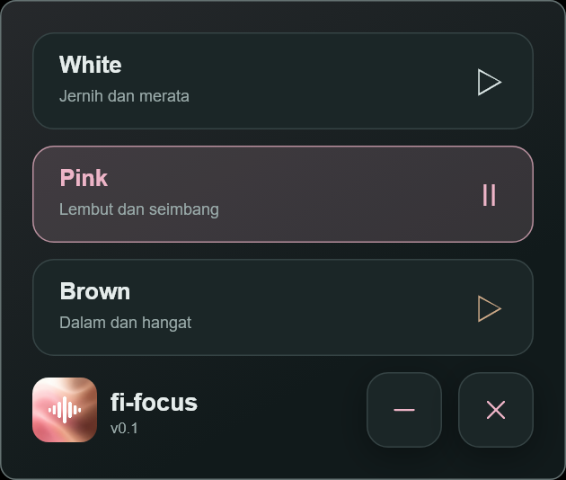
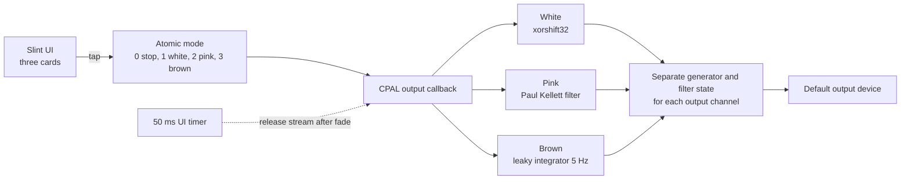

<p align="center"></p>

<h1 align="center">fi-focus</h1>

<p align="center">
  
  
  
  
</p>

<p align="center">White, pink, and brown noise generator to improve your focus, for Windows and Android. Every sample is generated live, build with Rust. Because your focus is your business, i give you zero telemetry.</p>

<p align="center"></p>

## Small on purpose

- No audio files. White, Pink, and Brown are three small generators, so the binary is the noise.
- The audio callback does no allocation, no I/O, and no logging.

## Specifications

| Card | On screen | Recipe | Target |
| --- | --- | --- | --- |
| White | Jernih dan merata | xorshift32, mapped to roughly ±1/30 | flat hiss |
| Pink | Lembut dan seimbang | Paul Kellett filter, 7 states, gain 0.33 | 1/f, about -3 dB/octave |
| Brown | Dalam dan hangat | leaky integrator at 5 Hz, input `sqrt(1 - a*a) * white`, output gain 2.2 | about -6 dB/octave, no DC drift |

## Architecture



## Build

You need Rust with the `aarch64-linux-android` target, a Windows MSVC toolchain, JDK 17, Android SDK 37, and an NDK. The example below uses NDK 28.2.13676358; check the path in your installation first. `ANDROID_HOME` and `JAVA_HOME` must point at your local installs.

```powershell
# Windows
cargo build --locked --release --manifest-path app/Cargo.toml
New-Item -ItemType Directory -Force dist/windows | Out-Null
Copy-Item app/target/release/fi-focus.exe dist/windows/fi-focus.exe

# Android native, target API 26 to match minSdk
$ndkBin = Join-Path $env:ANDROID_HOME 'ndk/28.2.13676358/toolchains/llvm/prebuilt/windows-x86_64/bin'
$env:CARGO_TARGET_AARCH64_LINUX_ANDROID_LINKER = Join-Path $ndkBin 'aarch64-linux-android26-clang.cmd'
$env:CC_aarch64_linux_android = $env:CARGO_TARGET_AARCH64_LINUX_ANDROID_LINKER
$env:AR_aarch64_linux_android = Join-Path $ndkBin 'llvm-ar.exe'
cargo build --locked --release --target aarch64-linux-android --lib --manifest-path app/Cargo.toml
New-Item -ItemType Directory -Force android/app/src/main/jniLibs/arm64-v8a | Out-Null
Copy-Item app/target/aarch64-linux-android/release/libfi_focus_lib.so android/app/src/main/jniLibs/arm64-v8a/libfi_focus_lib.so

# Android package
Push-Location android
try { ./gradlew.bat assembleRelease } finally { Pop-Location }
New-Item -ItemType Directory -Force dist/android | Out-Null
Copy-Item android/app/build/outputs/apk/release/app-release.apk dist/android/fi-focus-arm64.apk
```

## License

MIT. Keep the text with the code, as [LICENSE](LICENSE) says.

Third-party pieces keep their own licenses: the original 5mdt noise reference in [LICENSE-5mdt.txt](LICENSE-5mdt.txt), plus CPAL, jni, windows-sys, and Slint. Details are in [THIRD-PARTY-NOTICES.md](THIRD-PARTY-NOTICES.md). The Slint Royalty-free license asks for the badge below on public pages, so here it is.

<p align="center"><a href="https://slint.dev"></a></p>

## References

[1] J. T. Nigg, A. Bruton, M. B. Kozlowski, J. M. Johnstone, and S. L. Karalunas, “Systematic review and meta-analysis: Do white noise or pink noise help with task performance in youth with attention-deficit/hyperactivity disorder or with elevated attention problems?,” *J. Amer. Acad. Child Adolesc. Psychiatry*, vol. 63, no. 8, pp. 778–788, Aug. 2024, doi: [10.1016/j.jaac.2023.12.014](https://doi.org/10.1016/j.jaac.2023.12.014).

[2] P. Kellett, “Pink noise filter,” 1999, reproduced in R. Whittle, “DSP generation of pink noise.” Accessed: Nov. 4, 2026. [Online]. Available: https://www.firstpr.com.au/dsp/pink-noise/

[3] R. Bristow-Johnson, “Audio EQ cookbook,” W3C Working Group Note, Jun. 8, 2021. Accessed: Nov. 4, 2026. [Online]. Available: https://www.w3.org/TR/audio-eq-cookbook/
